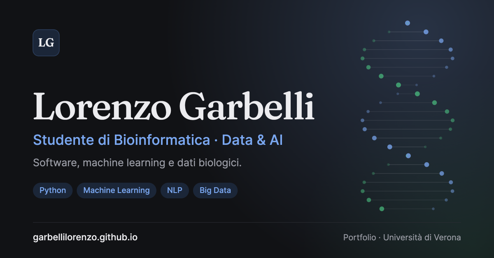

# Lorenzo Garbelli — Portfolio

[](https://garbellilorenzo.github.io)

Il mio sito personale: chi sono, competenze, progetti e contatti.
Sono uno studente di Bioinformatica all'Università di Verona e mi interessano machine learning, NLP e l'analisi di dati su larga scala.

🔗 **[garbellilorenzo.github.io](https://garbellilorenzo.github.io)**

---

## Caratteristiche

- **Nessuna dipendenza**: solo HTML, CSS e JavaScript, senza framework né build.
- **Tema chiaro e scuro**: segue le impostazioni del sistema, con un pulsante per cambiarlo che ricorda la scelta.
- **Responsive**: si adatta a telefono, tablet e desktop.
- **Accessibile**: link "Vai al contenuto", focus visibile da tastiera, animazioni disattivate se il sistema chiede movimento ridotto.
- **Contenuti in un solo file**: testi, progetti e link stanno tutti in [`content.js`](content.js).
- **Anteprima social**: immagine e meta tag Open Graph per LinkedIn, WhatsApp e altri.

## Privacy e sicurezza

- **Font ospitati nel sito**: i visitatori non si collegano a Google Fonts né ad altri servizi esterni.
- **Content Security Policy**: il browser esegue solo script e stili di questo sito.
- **Email protetta dai bot**: l'indirizzo non compare per intero nel codice e si forma solo quando il visitatore clicca "Mostra email".
- **Nessun tracciamento**: niente cookie, analytics o form che raccolgono dati.

## Struttura

```
├── index.html        Struttura della pagina e meta tag
├── content.js        ✏️ Tutti i contenuti del sito (l'unico file da modificare)
├── main.js           Inserisce i contenuti nella pagina, gestisce tema, animazioni ed email
├── theme.js          Applica il tema salvato prima del caricamento (evita il "flash")
├── style.css         Stile, colori dei due temi e layout responsive
└── assets/
    ├── fonts/        Inter e Fraunces in formato woff2
    ├── favicon.svg   Icona del sito
    └── og-image.png  Anteprima per i social (1200×627)
```

## Modificare i contenuti

Apri [`content.js`](content.js) e cambia testi, competenze, progetti, percorso o link. Per aggiungere un progetto basta un nuovo elemento nella lista `projects`:

```js
{
  title: "Nome del progetto",
  description: "Breve descrizione di cosa fa.",
  tags: ["Python", "Machine Learning"],
  repo: "https://github.com/garbellilorenzo/nome-repo",
  demo: "", // lascia vuoto se non c'è una demo
},
```

## Vederlo in locale

Serve un piccolo server, perché aprendo `index.html` con doppio clic alcuni browser bloccano gli script:

```bash
python3 -m http.server 5173
```

Poi apri <http://localhost:5173>.

## Pubblicazione

Il sito è pubblicato con **GitHub Pages** dal branch `main`. Ogni push aggiorna il sito online in circa un minuto:

```bash
git add -A
git commit -m "Aggiorna contenuti"
git push
```

## Crediti

- Font [Inter](https://rsms.me/inter/) di Rasmus Andersson e [Fraunces](https://github.com/undercasetype/Fraunces) di Undercase Type, entrambi con licenza [SIL Open Font License 1.1](https://openfontlicense.org).

## Contatti

- GitHub: [@garbellilorenzo](https://github.com/garbellilorenzo)
- LinkedIn: [Lorenzo Garbelli](https://www.linkedin.com/in/lorenzo-garbelli-76625b242/)
- Email: dal pulsante "Mostra email" sul [sito](https://garbellilorenzo.github.io/#contact)
